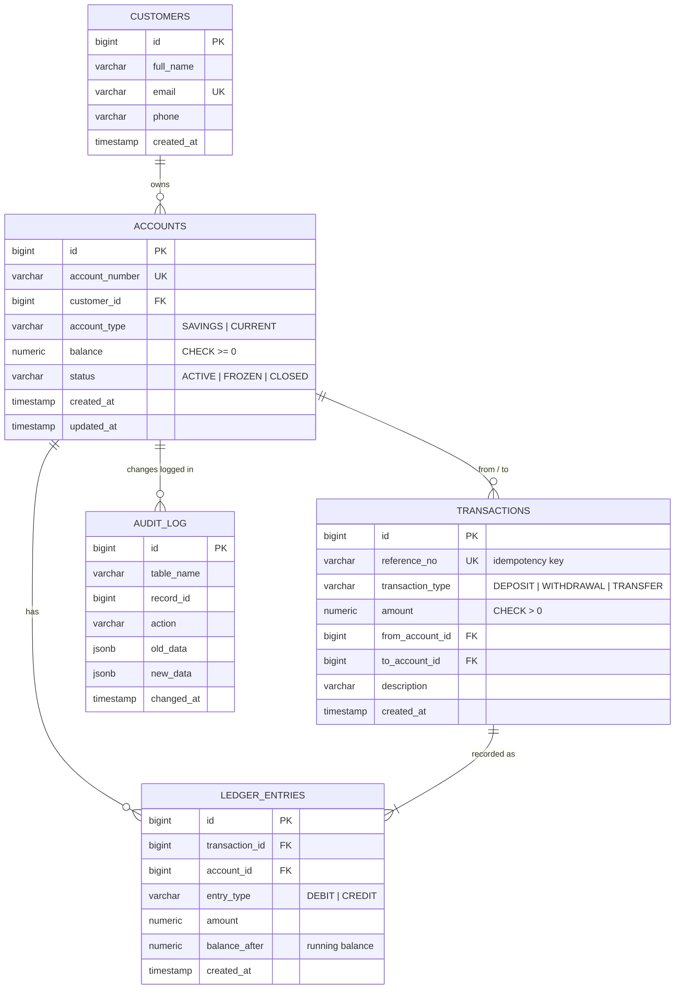

# Banking Transaction System

A backend banking service built with **Spring Boot** and **PostgreSQL** that handles accounts, deposits,
withdrawals and transfers **without ever losing or duplicating money**, even when hundreds of requests
hit the same accounts at the same time.

The focus of this project is correctness under concurrency: ACID transactions, row-level locking,
deadlock prevention, idempotent requests, a double-entry ledger and a tamper-proof audit trail.

---

## Features

| Feature | How it works |
|---|---|
| Customers and accounts | Savings / current accounts with readable 12-digit account numbers from a DB sequence |
| Deposit, withdraw, transfer | Each operation runs in a single database transaction: all-or-nothing |
| No lost updates | Accounts are locked with `SELECT ... FOR UPDATE` before balances are read |
| No deadlocks | When two accounts are involved they are always locked in the same order |
| Idempotent requests | A client `referenceNo` (unique in the DB) makes retries safe: money moves only once |
| Double-entry ledger | Every transfer writes a DEBIT and a CREDIT of equal amount, with running balance |
| Audit trail | A PostgreSQL trigger records every balance/status change automatically |
| Immutable history | Triggers block `UPDATE`/`DELETE` on the ledger and audit tables |
| DB-level safety net | `CHECK (balance >= 0)` - the database refuses negative balances even if the code has a bug |
| Statements and reports | Date-range statement with opening/closing balance; monthly summary from a SQL view |
| Account status | Freeze / unfreeze / close (closing requires zero balance) |

## Tech stack

- **Java 17**, **Spring Boot 3.3** (Web, Data JPA, Validation)
- **PostgreSQL 16** with **Flyway** migrations
- **JUnit 5**, AssertJ, MockMvc - including a multi-threaded concurrency test
- **Docker** and Docker Compose

---

## Database design



Schema lives in [`src/main/resources/db/migration`](src/main/resources/db/migration):

- `V1__create_core_tables.sql` - tables, constraints, indexes
- `V2__audit_trigger_and_reports.sql` - audit trigger, immutability triggers, monthly summary view

Design decisions:

- **Money is `NUMERIC(15,2)`**, never `FLOAT`, so there are no rounding errors.
- **Indexes match the queries**: `ledger_entries(account_id, created_at)` serves statements directly.
- **`balance` is stored *and* derivable**: the ledger lets you rebuild any balance and audit it.

---

## How a transfer stays correct

```text
BEGIN
  1. Lock both accounts:  SELECT ... FOR UPDATE   (smaller account number first)
  2. Check referenceNo:   already processed?  -> return the original result (safe retry)
  3. Check status and funds                   -> error = ROLLBACK, nothing changes
  4. Debit sender, credit receiver
  5. Insert transaction row + DEBIT and CREDIT ledger rows
  6. Trigger writes audit rows
COMMIT
```

| Problem | Without protection | Solution used |
|---|---|---|
| **Lost update** | Two withdrawals both read balance 1000, both write 900 - one withdrawal vanishes | Row lock (`FOR UPDATE`): the second waits and reads the new balance |
| **Deadlock** | A->B locks A then B, B->A locks B then A; each waits forever | Lock in a fixed order (by account number) so they queue instead |
| **Double payment** | Client times out and retries; money is sent twice | Unique `reference_no`, checked *after* locking, so retries see the first result |
| **Partial transfer** | Crash after debit, before credit | One database transaction: commit both or roll back both |
| **Overdraft by bug** | Code mistake makes a balance negative | `CHECK (balance >= 0)` in the database |

The core logic is in [`TransactionService.java`](src/main/java/com/anil/banking/service/TransactionService.java).

---

## Project structure

```text
src/main/java/com/anil/banking
├── controller/   REST endpoints (customers, accounts, transfers)
├── service/      business logic and transaction boundaries
├── repository/   Spring Data JPA repositories (incl. locking query)
├── entity/       JPA entities and enums
├── dto/          request/response records with validation
└── exception/    custom exceptions + global JSON error handler

src/main/resources
├── application.yml
└── db/migration/ Flyway SQL migrations

src/test/java/com/anil/banking
├── service/TransactionServiceTest.java   business rules
├── service/ConcurrentTransferTest.java   400 parallel transfers, 20 threads
└── controller/ApiTest.java               HTTP status codes and validation
```

---

## Running the project

### Option A: everything in Docker (no Java needed)

```bash
docker compose up --build
```

The API is then available at `http://localhost:8080/api`.

### Option B: run locally (for development)

Requirements: Java 17+, Maven 3.9+, Docker (for PostgreSQL).

```bash
docker compose up -d db        # start only PostgreSQL
mvn spring-boot:run            # start the app
```

## Running the tests

Tests run against a real PostgreSQL database (`banking_test`, created automatically by Docker Compose).

```bash
docker compose up -d db
mvn test
```

No Java or Maven installed? Run the tests inside Docker instead (from the project folder):

```bash
docker run --rm --network banking-transaction-system_default \
  -v "$PWD:/app" -v banking-m2:/root/.m2 -w /app \
  -e TEST_DB_URL=jdbc:postgresql://db:5432/banking_test \
  maven:3.9-eclipse-temurin-17 mvn test
```

```text
Tests run: 17, Failures: 0, Errors: 0, Skipped: 0
BUILD SUCCESS
```

> If you created the database container before `docker/init-test-db.sql` existed, run
> `docker exec -it banking-db psql -U banking -c "CREATE DATABASE banking_test;"` once.

---

## API

| Method | Endpoint | Description |
|---|---|---|
| POST | `/api/customers` | Create a customer |
| GET | `/api/customers/{id}` | Get a customer |
| GET | `/api/customers/{id}/accounts` | List a customer's accounts |
| POST | `/api/accounts` | Open an account |
| GET | `/api/accounts/{accountNumber}` | Account details and balance |
| PATCH | `/api/accounts/{accountNumber}/status` | Freeze / unfreeze / close |
| POST | `/api/accounts/{accountNumber}/deposit` | Deposit |
| POST | `/api/accounts/{accountNumber}/withdraw` | Withdraw |
| POST | `/api/transfers` | Transfer between accounts |
| GET | `/api/transactions/{referenceNo}` | Look up a transaction |
| GET | `/api/accounts/{accountNumber}/statement?from=YYYY-MM-DD&to=YYYY-MM-DD` | Statement |
| GET | `/api/accounts/{accountNumber}/summary` | Monthly credit/debit summary |

Ready-to-run examples: [`api-requests.http`](api-requests.http) (IntelliJ / VS Code REST Client).

### Example: transfer

```bash
curl -X POST http://localhost:8080/api/transfers \
  -H "Content-Type: application/json" \
  -d '{"fromAccountNumber":"100000000001","toAccountNumber":"100000000002",
       "amount":1200.00,"referenceNo":"RENT-OCT-2026","description":"October rent"}'
```

```json
{
  "referenceNo": "RENT-OCT-2026",
  "type": "TRANSFER",
  "amount": 1200.00,
  "fromAccountNumber": "100000000001",
  "toAccountNumber": "100000000002",
  "description": "October rent",
  "createdAt": "2026-10-17T11:30:12.123456"
}
```

### Error responses

| Status | When |
|---|---|
| 400 | Validation failed (field errors included) |
| 404 | Customer, account or transaction not found |
| 409 | Duplicate email, or `referenceNo` reused for a different request |
| 422 | Insufficient funds, frozen/closed account, transfer to same account |

```json
{
  "timestamp": "2026-10-17T11:31:02.551",
  "status": 422,
  "error": "Unprocessable Entity",
  "message": "Insufficient funds in account 100000000002: balance 1200.00, requested 99999.00",
  "path": "/api/accounts/100000000002/withdraw"
}
```

---

## Possible extensions

- JWT authentication with Spring Security (customers see only their own accounts)
- Daily withdrawal limits and transaction fees
- Scheduled interest posting for savings accounts
- Swagger / OpenAPI documentation
- Testcontainers so tests start their own PostgreSQL automatically