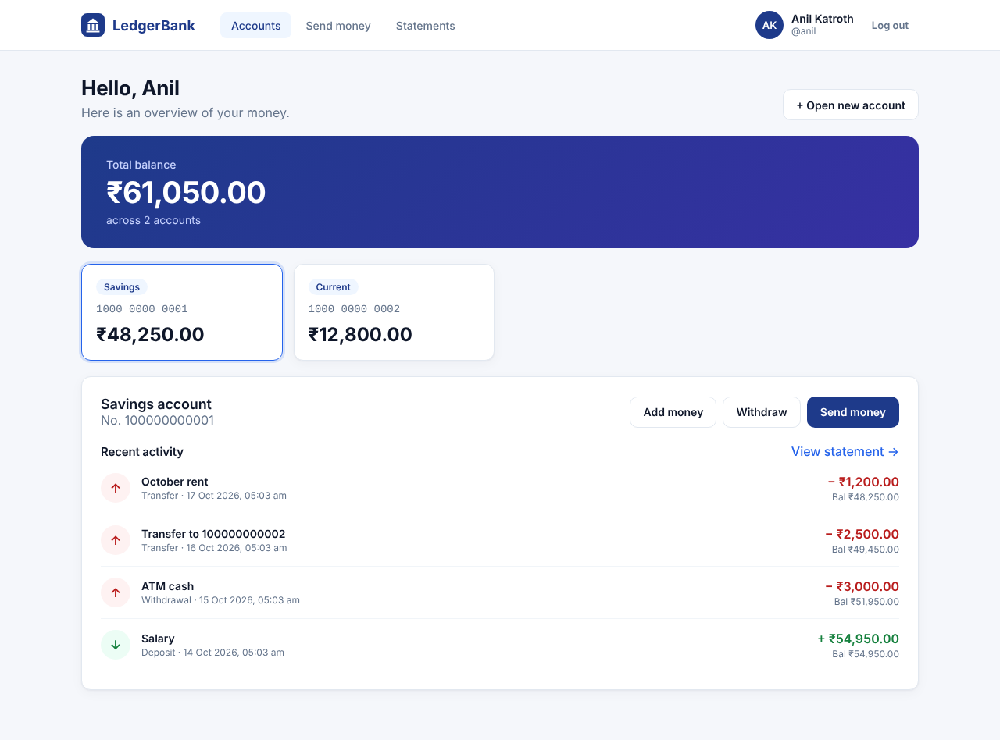
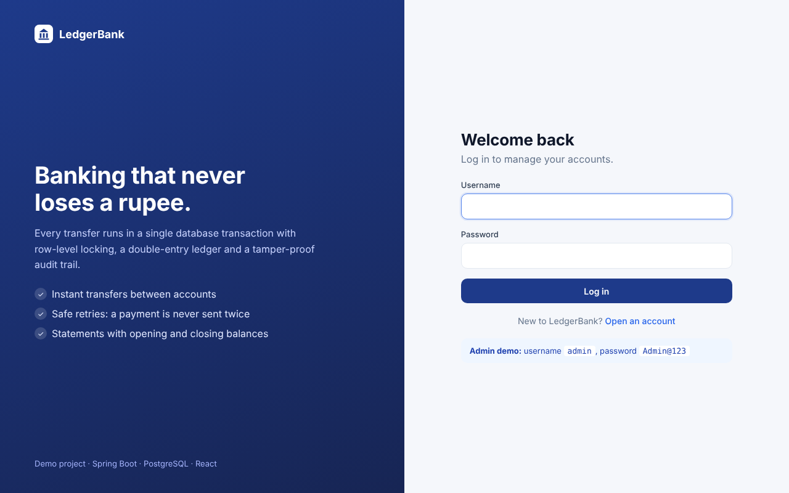
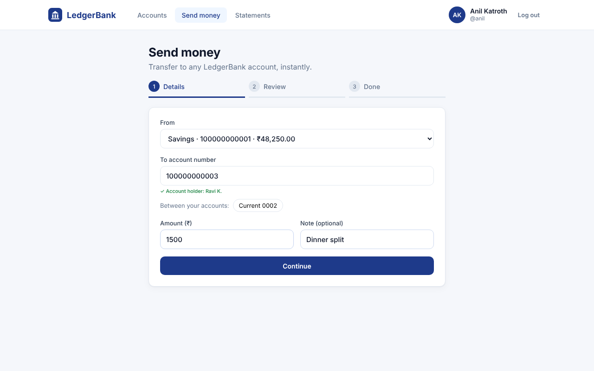
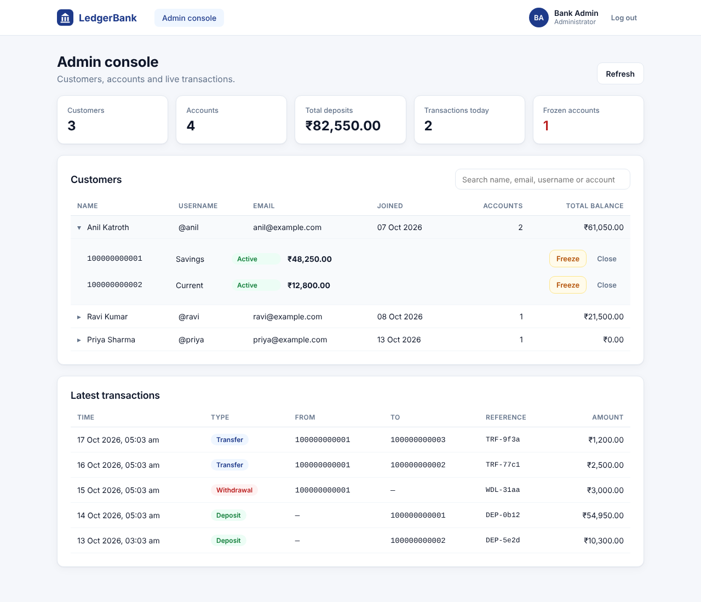
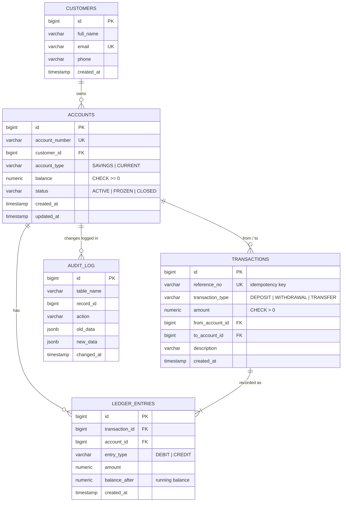

# Banking Transaction System

A full-stack banking application: a **React** web app on top of a **Spring Boot + PostgreSQL** API.
Customers sign up, log in and manage their accounts (deposit, withdraw, transfer, statements);
bank staff use an admin console to see every customer and freeze accounts.

Under the hood, every money movement is **ACID-safe**: row-level locking, deadlock prevention,
idempotent requests, a double-entry ledger and a tamper-proof audit trail mean money is never lost
or duplicated, even when hundreds of requests hit the same accounts at once.



| Login | Send money | Admin console |
|---|---|---|
|  |  |  |

More screens in [`docs/screenshots`](docs/screenshots).

---

## Features

| Feature | How it works |
|---|---|
| Customers and accounts | Savings / current accounts with readable 12-digit account numbers from a DB sequence |
| Deposit, withdraw, transfer | Each operation runs in a single database transaction: all-or-nothing |
| No lost updates | Accounts are locked with `SELECT ... FOR UPDATE` before balances are read |
| No deadlocks | When two accounts are involved they are always locked in the same order |
| Idempotent requests | A client `referenceNo` (unique in the DB) makes retries safe: money moves only once |
| Double-entry ledger | Every transfer writes a DEBIT and a CREDIT of equal amount, with running balance |
| Audit trail | A PostgreSQL trigger records every balance/status change automatically |
| Immutable history | Triggers block `UPDATE`/`DELETE` on the ledger and audit tables |
| DB-level safety net | `CHECK (balance >= 0)` - the database refuses negative balances even if the code has a bug |
| Statements and reports | Date-range statement with opening/closing balance; monthly summary from a SQL view |
| Account status | Freeze / unfreeze / close (closing requires zero balance) |
| Login and sign-up | Spring Security with stateless **JWT** tokens; passwords hashed with **BCrypt** |
| Roles | `CUSTOMER` sees only their own accounts; `ADMIN` sees everyone and can freeze or close accounts |
| Ownership checks | Every account endpoint verifies the account belongs to the logged-in customer (403 otherwise) |
| Web app | React pages for login, sign-up, dashboard, transfers (with review step), statements, admin console |

## Tech stack

- **Java 17**, **Spring Boot 3.3** (Web, Data JPA, Validation, **Security**), **JWT** (jjwt)
- **React 18** + **Vite** + React Router for the web app
- **PostgreSQL 16** with **Flyway** migrations
- **JUnit 5**, AssertJ, MockMvc - including a multi-threaded concurrency test
- **Swagger UI** (springdoc-openapi) for interactive API docs, **pgAdmin** for browsing the database
- **Docker** and Docker Compose

---

## Database design



Schema lives in [`src/main/resources/db/migration`](src/main/resources/db/migration):

- `V1__create_core_tables.sql` - tables, constraints, indexes
- `V2__audit_trigger_and_reports.sql` - audit trigger, immutability triggers, monthly summary view
- `V3__users_and_roles.sql` - login accounts (`users`) with roles, linked one-to-one to customers

Design decisions:

- **Money is `NUMERIC(15,2)`**, never `FLOAT`, so there are no rounding errors.
- **Indexes match the queries**: `ledger_entries(account_id, created_at)` serves statements directly.
- **`balance` is stored *and* derivable**: the ledger lets you rebuild any balance and audit it.

---

## How a transfer stays correct

```text
BEGIN
  1. Lock both accounts:  SELECT ... FOR UPDATE   (smaller account number first)
  2. Check referenceNo:   already processed?  -> return the original result (safe retry)
  3. Check status and funds                   -> error = ROLLBACK, nothing changes
  4. Debit sender, credit receiver
  5. Insert transaction row + DEBIT and CREDIT ledger rows
  6. Trigger writes audit rows
COMMIT
```

| Problem | Without protection | Solution used |
|---|---|---|
| **Lost update** | Two withdrawals both read balance 1000, both write 900 - one withdrawal vanishes | Row lock (`FOR UPDATE`): the second waits and reads the new balance |
| **Deadlock** | A->B locks A then B, B->A locks B then A; each waits forever | Lock in a fixed order (by account number) so they queue instead |
| **Double payment** | Client times out and retries; money is sent twice | Unique `reference_no`, checked *after* locking, so retries see the first result |
| **Partial transfer** | Crash after debit, before credit | One database transaction: commit both or roll back both |
| **Overdraft by bug** | Code mistake makes a balance negative | `CHECK (balance >= 0)` in the database |

The core logic is in [`TransactionService.java`](src/main/java/com/anil/banking/service/TransactionService.java).

---

## Security

```text
Browser (React)                          Spring Boot
  POST /api/auth/login  ───────────────▶  check BCrypt hash  ──▶  return signed JWT (60 min)
  GET  /api/me/accounts                   JwtAuthenticationFilter: verify signature + expiry
       Authorization: Bearer <JWT> ─────▶  SecurityConfig: is the route allowed for this role?
                                           AccessGuard: does this account belong to this customer?
```

- **Passwords** are stored only as BCrypt hashes.
- **Stateless**: no server sessions; every request carries the JWT, so CSRF protection is not needed.
- **Roles**: `/api/admin/**`, opening accounts for others and changing account status require `ADMIN`.
- **Ownership**: customers can read and move money only from their own accounts (403 otherwise),
  but can send money *to* any account number, like a real bank.
- **Login errors** use one message for "unknown user" and "wrong password", so usernames cannot be probed.
- A default admin (`admin` / `Admin@123`) is created on first start. Override with `ADMIN_PASSWORD`, and set
  `JWT_SECRET` (32+ characters) for any real deployment.

---

## Project structure

```text
src/main/java/com/anil/banking
├── controller/   REST endpoints (auth, me, accounts, transfers, admin)
├── service/      business logic and transaction boundaries
├── security/     JWT service and filter, Spring Security config, ownership guard
├── repository/   Spring Data JPA repositories (incl. locking query)
├── entity/       JPA entities and enums
├── dto/          request/response records with validation
├── config/       Swagger setup, admin user seeding
└── exception/    custom exceptions + global JSON error handler

src/main/resources/db/migration/   Flyway SQL migrations

frontend/src
├── pages/        Login, Register, Dashboard, Transfer, Statement, Admin
├── components/   layout, modal, activity list, route guard
├── api.js        fetch wrapper that attaches the JWT
└── auth.jsx      login state (React context)

src/test/java/com/anil/banking
├── service/TransactionServiceTest.java   business rules
├── service/ConcurrentTransferTest.java   400 parallel transfers, 20 threads
└── controller/ApiTest.java               login, JWT, roles, ownership, validation over HTTP
```

---

## Running the project

Requirements: **Java 17+**, **Node.js 18+**, **Docker** (for PostgreSQL). Maven is optional (see below).

**1. Start PostgreSQL**

```bash
docker compose up -d db
```

The database is published on host port **5433** (not 5432) so it never clashes with a PostgreSQL
installed directly on your machine.

**2. Start the backend** (port 8080)

```bash
mvn spring-boot:run
```

No Maven installed? Build the jar with Docker, then run it with Java:

```bash
docker run --rm -v "$PWD:/app" -v banking-m2:/root/.m2 -w /app maven:3.9-eclipse-temurin-17 mvn -q package -DskipTests
java -jar target/banking-transaction-system-1.0.0.jar
```

**3. Start the web app** (port 5173)

```bash
cd frontend
npm install
npm run dev
```

Open **http://localhost:5173**. Sign up as a customer, or log in as the admin (`admin` / `Admin@123`).
The Vite dev server forwards `/api` calls to the backend on port 8080.

### Other tools

| Tool | URL | What it is for |
|---|---|---|
| **Swagger UI** | http://localhost:8080/swagger-ui.html | Raw API: log in via `/api/auth/login`, click *Authorize*, paste the token |
| **pgAdmin** | http://localhost:5050 (`admin@banking.com` / `admin`), start with `docker compose up -d pgadmin` | Watch balances, ledger rows and the audit log change |

Useful queries in pgAdmin (*Tools → Query Tool*, server *Banking DB*, password `banking`):

```sql
SELECT account_number, balance, status FROM accounts ORDER BY id;
SELECT * FROM ledger_entries ORDER BY id DESC LIMIT 20;
SELECT record_id, action, old_data, new_data, changed_at FROM audit_log ORDER BY id DESC LIMIT 20;
```

---

## Running the tests

Tests run against a real PostgreSQL database (`banking_test`, created automatically by Docker Compose).

```bash
docker compose up -d db
mvn test
```

No Java or Maven installed? Run the tests inside Docker instead (from the project folder):

```bash
docker run --rm --network banking-transaction-system_default \
  -v "$PWD:/app" -v banking-m2:/root/.m2 -w /app \
  -e TEST_DB_URL=jdbc:postgresql://db:5432/banking_test \
  maven:3.9-eclipse-temurin-17 mvn test
```

> If you created the database container before `docker/init-test-db.sql` existed, run
> `docker exec -it banking-db psql -U banking -c "CREATE DATABASE banking_test;"` once.

---

## API

All endpoints except register and login need `Authorization: Bearer <token>`.

| Method | Endpoint | Who | Description |
|---|---|---|---|
| POST | `/api/auth/register` | anyone | Sign up: customer + login + first savings account; returns a token |
| POST | `/api/auth/login` | anyone | Log in; returns a token |
| GET | `/api/auth/me` | logged in | Own profile and accounts |
| GET | `/api/me/accounts` | customer | Own accounts |
| POST | `/api/me/accounts` | customer | Open another account |
| GET | `/api/accounts/{no}` | owner / admin | Account details and balance |
| GET | `/api/accounts/{no}/holder` | logged in | Masked holder name, to confirm a transfer receiver |
| POST | `/api/accounts/{no}/deposit` | owner / admin | Deposit |
| POST | `/api/accounts/{no}/withdraw` | owner / admin | Withdraw |
| POST | `/api/transfers` | owner of source | Transfer to any account |
| GET | `/api/accounts/{no}/transactions?limit=10` | owner / admin | Recent activity |
| GET | `/api/accounts/{no}/statement?from=YYYY-MM-DD&to=YYYY-MM-DD` | owner / admin | Statement |
| GET | `/api/accounts/{no}/summary` | owner / admin | Monthly credit/debit summary |
| GET | `/api/transactions/{referenceNo}` | sender / receiver / admin | Look up a transaction |
| PATCH | `/api/accounts/{no}/status` | admin | Freeze / unfreeze / close |
| GET | `/api/admin/stats` | admin | Totals for the admin console |
| GET | `/api/admin/customers` | admin | All customers with their accounts |
| GET | `/api/admin/transactions?limit=50` | admin | Latest transactions |

### Error responses

| Status | When |
|---|---|
| 400 | Validation failed (field errors included) |
| 401 | Missing, invalid or expired token; wrong username or password |
| 403 | Account belongs to someone else, or admin-only endpoint |
| 404 | Customer, account or transaction not found |
| 409 | Duplicate username or email, or `referenceNo` reused for a different request |
| 422 | Insufficient funds, frozen/closed account, transfer to same account |

```json
{
  "timestamp": "2026-10-17T11:31:02.551",
  "status": 422,
  "error": "Unprocessable Entity",
  "message": "Insufficient funds in account 100000000002: balance 1200.00, requested 99999.00",
  "path": "/api/accounts/100000000002/withdraw"
}
```

---

## Possible extensions

- Refresh tokens and logout-everywhere (token revocation list)
- Daily withdrawal limits and transaction fees
- Scheduled interest posting for savings accounts
- Testcontainers so tests start their own PostgreSQL automatically
